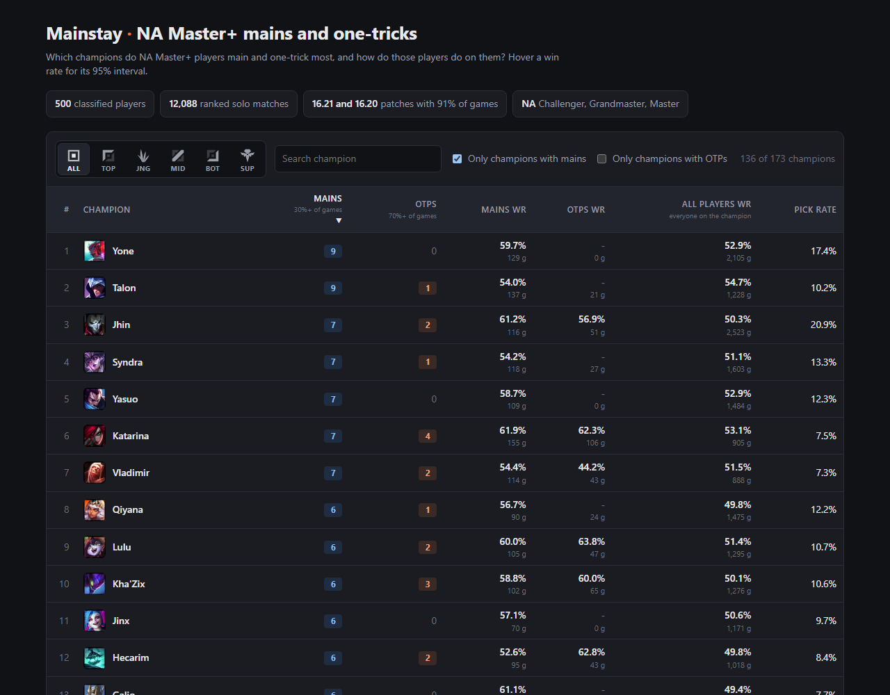
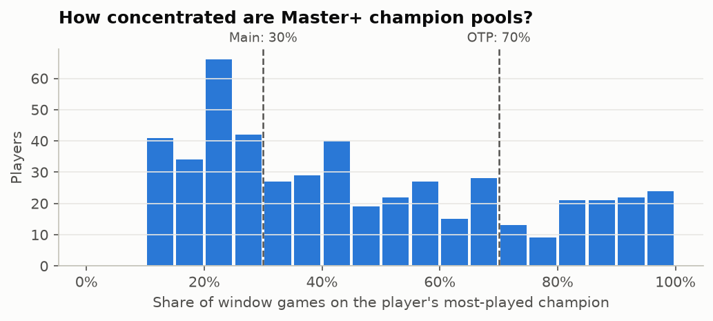
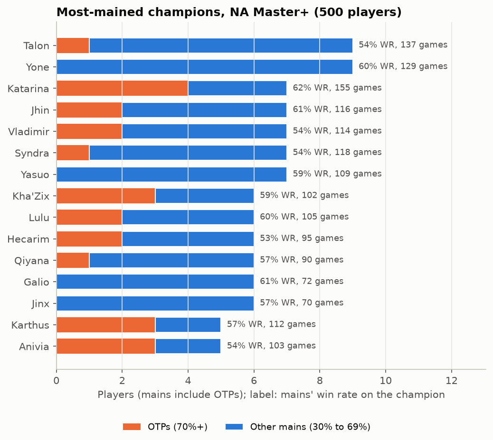
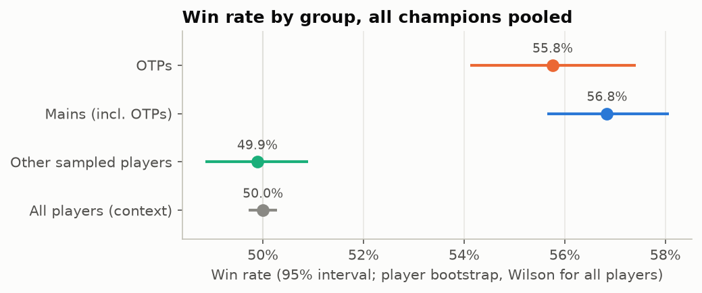
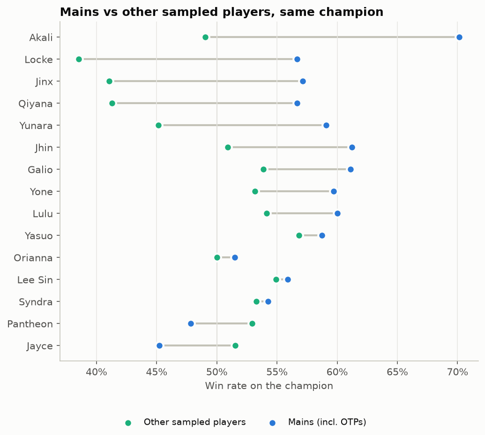
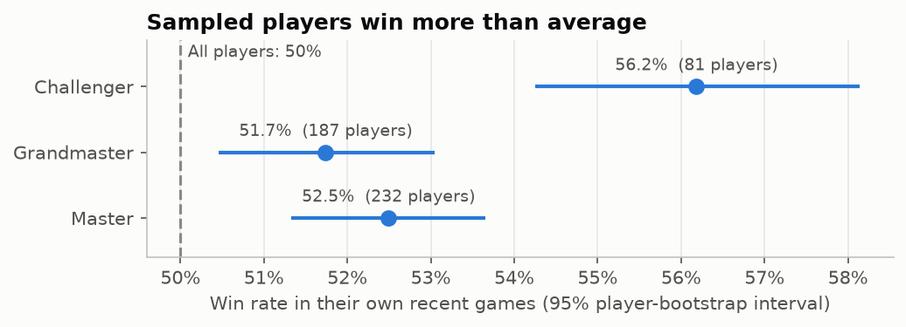

# Mains and One-Tricks in NA Master+

A SQL and Python analysis of which League of Legends champions the highest-ranked North American solo queue players main and one-trick most, and how those players do on them. Inspired by sites like onetricks.gg and lolalytics, built from data collected through the Riot Games API.

**Tools:** Python (requests, pandas, matplotlib), SQLite, the Riot Games API.

> **Status:** prototype (500 players, 12,211 matches, collected Nov 1, 2026).

**Key findings**

- **Two thirds of Master+ players have a main.** 331 of 500 sampled players play at least 30% of their recent games on one champion, and 122 are one-tricks at 70% or more.
- **Mains are spread across many champions.** 136 of 173 champions have at least one main and 85 have a one-trick. Talon and Yone have the most mains (9 each); Katarina has the most one-tricks (4).
- **Mains win more on their champion than other players on it.** On the same champion, mains win 7.3 percentage points more than other sampled players (95% interval +5.6 to +9.2). One-tricks show no further edge over mains.



## The questions

1. **Main question:** Which champions do NA Master+ players main (30% or more of their games) and one-trick (70% or more) most, and what are those players' win rates on them?
2. **Secondary question:** Do mains win more on their champion than other Master+ players on the same champion?

The main output is a sortable champion table (number of mains and one-tricks, their win rates, and every player's win rate on the champion), with a filter for each role.

## Results

### Most Master+ players have a main

Each player's share of games on their most-played champion:



### Most-mained champions

| Champion | Mains | One-tricks | Mains' win rate | Mains' games | All players' win rate |
|---|---|---|---|---|---|
| Talon | 9 | 1 | 54.0% | 137 | 54.7% |
| Yone | 9 | 0 | 59.7% | 129 | 52.9% |
| Katarina | 7 | 4 | 61.9% | 155 | 53.1% |
| Jhin | 7 | 2 | 61.2% | 116 | 50.3% |
| Vladimir | 7 | 2 | 54.4% | 114 | 51.5% |
| Syndra | 7 | 1 | 54.2% | 118 | 51.1% |
| Yasuo | 7 | 0 | 58.7% | 109 | 52.9% |
| Kha'Zix | 6 | 3 | 58.8% | 102 | 50.1% |
| Lulu | 6 | 2 | 60.0% | 105 | 51.4% |
| Hecarim | 6 | 2 | 52.6% | 95 | 49.8% |



How to read this:

- **Mains' win rates are above 50% almost everywhere.** That says more about the players than the champions: they were picked from the current ladder, so they have been winning (see [Method](#method)). The "all players" column, everyone on the champion in the same matches, is the better guide to how strong a champion is.
- **The order is not precise.** With 500 players, the top champions have 5 to 9 mains each, so one or two players can change the ranking. The full table on the results page has every champion and role.

### Secondary: do mains win more than other players on the same champion?

| Group | Players | Games | Win rate | 95% interval |
|---|---|---|---|---|
| Mains (incl. OTPs), on their champion | 331 | 6,235 | 56.8% | 55.7% to 58.1% |
| One-tricks, on their champion | 122 | 3,099 | 55.8% | 54.1% to 57.4% |
| Other sampled players, on non-main champions | 486 | 8,613 | 49.9% | 48.9% to 50.9% |
| All players in these matches (context) | | 120,880 | 50.0% | 49.7% to 50.3% |

Intervals for the first three rows come from a player bootstrap; the last row uses a Wilson interval.



Pooled numbers mix champions, so the comparison is also made **within each champion** and then averaged across champions:

| Comparison | Difference | 95% interval |
|---|---|---|
| Mains vs other sampled players | **+7.3 points** | +5.6 to +9.2 |
| One-tricks vs other sampled players | **+5.6 points** | +3.1 to +8.6 |

Both intervals are well above zero. One-tricks do not beat mains: their interval overlaps the mains' interval, so this sample shows no extra benefit from playing one champion almost exclusively. Part of the gap is likely selection rather than skill (see [Limitations](#limitations)).

15 champions have at least 3 mains, 60 mains' games and 60 games from other sampled players. 13 of the 15 show mains ahead, but with only 4 to 9 mains per champion these rows are noisy. Treat them as examples, not rankings.



## Data

| | |
|---|---|
| Region and queue | NA, ranked solo queue (queue 420) |
| Player pool | All Challenger (300) and Grandmaster (700) players, plus a random 1,000 of the 10,000 Master players (seed 42), drawn on Oct 31, 2026 |
| Prototype sample | 500 of the 2,000 players (first 500 ordered by PUUID, which is effectively random and mixes tiers) |
| Games per player | Each player's newest 30 ranked solo games |
| Matches | 12,211 unique matches, all 10 participants stored |
| Players by tier | 81 Challenger, 187 Grandmaster, 232 Master |
| Patches | 62% on 16.21, 29% on 16.20, the rest older; the patch is stored on every match |

Remakes (games that ended in an early surrender) are removed everywhere.

## Definitions

A player's **share** of a champion is the fraction of their 30-game window played on it.

- **Main:** share of 30% or more. A player can main up to three champions. Mains include one-tricks.
- **One-trick (OTP):** share of 70% or more. A player can be a one-trick of at most one champion.
- A player needs at least 15 non-remake games in the window to be labeled.
- Win rates for mains and one-tricks use only their games on that champion.

The labels are computed in SQL from the stored games, not saved in the database, so the thresholds can be changed without collecting more data.

## Method

### Why mains' win rates are above 50%

The sampled players were chosen *because* they are currently on the Master+ ladder, which means they have been winning recently. All participants in their matches average exactly 50% (every game has five winners and five losers), but the sampled players themselves win more: 56% for Challenger, 52% for Grandmaster and 53% for Master.



So a mains' win rate above 50% mostly describes these players, not the champion. The "all players" column (everyone on the champion in the same matches) shows how the champion itself is doing.

For the same reason, the secondary question does not compare mains with all players, since part of any gap would just come from how players were picked. It compares them with **other sampled players**: players from the same sample who played the champion but are not mains of it, picked the same way.

The results show where the selection effect lives: other sampled players win 49.9%, no better than everyone else. The sampled players' above-average records come almost entirely from games on their mains. Those players reached Master+ largely by winning on their mains, which is the same thing this project measures. See [Limitations](#limitations).

### Uncertainty

Games from the same player are not independent. A player who wins a lot will win a lot of their games, so treating every game as a separate coin flip makes intervals too narrow. For that reason:

- **Pooled win rates** use a **player-level bootstrap**: resample players (not games) with replacement 2,000 times and take the 2.5th and 97.5th percentiles.
- **The same-champion difference** compares mains with other sampled players *within each champion*, then combines champions with Mantel-Haenszel style weights (`w = M * O / (M + O)`, where M and O are the two groups' game counts). This stops champions with high win rates from creating a fake difference when mains and others play different champions. The interval comes from the same player bootstrap.
- **Per-champion rows** on the results page show Wilson 95% intervals when hovered, and hide win rates based on fewer than 30 games. The per-champion mains vs others chart only includes champions with at least 3 mains, 60 main games and 60 other games.

### Pipeline

| Step | File | What it does |
|---|---|---|
| 1 | `src/riot_client.py` | API client: sends the key in a header, spaces calls 1.3 s apart to respect rate limits, retries on 429 and 5xx |
| 2 | `sql/schema.sql`, `src/db.py` | SQLite schema: players, match ID lists, matches, participants, compressed raw JSON |
| 3 | `src/collect_players.py` | Draws the player pool from the Challenger, Grandmaster and Master ladders |
| 4 | `src/collect_match_ids.py` | Stores each player's newest 100 ranked solo match IDs |
| 5 | `src/collect_matches.py` | Downloads match details, newest first; resumable and skips stored matches |
| 6 | `sql/champion_table.sql`, `sql/player_champions.sql` | Labels players and builds the per-champion table (CTEs, window functions, conditional aggregation) |
| 7 | `notebooks/analysis.ipynb` | Charts, player bootstrap, same-champion difference |
| 8 | `src/extract_details.py` | Extracts full rune pages and Riot IDs from the stored match JSON (no API calls) |
| 9 | `sql/main_games.sql`, `src/champion_pages.py` | One row per main's game on their champion, with items, spells, runes and the lane opponent (a self-join) |
| 9b | `src/collect_timelines.py`, `sql/main_purchases.sql`, `sql/skill_order.sql` | Downloads match timelines for mains' games (5,701 matches), keeps only item and skill events, and derives starting items, build order (undone purchases removed) and skill order with window functions |
| 10 | `src/build_site.py` | Writes the site's data as JSON (`web/public/data/`): the champion table and one file per champion |
| 11 | `web/` | The website, in React + TypeScript (Vite): a sortable champion table with a role filter, and a page per champion with Build, Players and Counters tabs |

## Limitations

- **Survivorship and selection.** Players reach Master+ by winning, and the ladder is a snapshot from one day. Since other sampled players win only 50%, the recent winning that put players on the ladder sits in their mains' games. This study cannot separate "mains are better on their champion" from "players climbed by winning on their main"; both describe the same games. A cleaner test would follow players forward in time from a fixed date, so that future games are not part of how players were chosen.
- **Players keep playing what they win on.** A player on a winning streak with a champion is more likely to keep picking it, which pushes up that champion's share and win rate together. This could make mains look better than they are.
- **Noisy labels.** With 30 games, a player's share is only precise to roughly plus or minus 8 points, so players near the 30% and 70% cutoffs can be labeled differently by chance.
- **Small prototype.** With 500 players, even the most-mained champions have only 5 to 9 mains, so the champion order and per-champion win rates are rough. Win rates based on fewer than 30 games are hidden on the results page. More players would sharpen both.
- **Several patches.** Games span multiple patches, and champion balance changes between them.
- **One region, one rank range.** The results are for NA Master+ only.

## How to reproduce

You need Python 3.12 or newer and a Riot developer key from [developer.riotgames.com](https://developer.riotgames.com).

```bash
python -m venv .venv
.venv\Scripts\activate          # Windows; use source .venv/bin/activate elsewhere
pip install -r requirements.txt
```

Create a file named `.env` in the repo root with one line:

```
RIOT_API_KEY=your-key-here
```

Then run:

```bash
python src/collect_players.py     # draw the player pool (once)
python src/collect_match_ids.py   # match ID lists, about 45 minutes
python src/collect_matches.py     # match details for the sample, about 4 hours
python src/champion_table.py      # print the pooled summary and table
python src/extract_details.py     # runes and Riot IDs from the stored JSON
python src/collect_timelines.py    # item and skill timelines for mains' games, about 2 hours
python src/build_site.py          # write the site's JSON data to web/public/data/
```

To view the website (needs [Node.js](https://nodejs.org) 20 or newer):

```bash
cd web
npm install                       # once
npm run dev                       # then open the address it prints
```

`npm run build` writes a static copy to `web/dist/`.

Open `notebooks/analysis.ipynb` for the charts. The sample size and window are set in `src/settings.py` and in the `settings` CTE at the top of each file in `sql/`.

A new draw will give a different ladder snapshot, so exact numbers will differ from the ones above.

## Legal

This project isn't endorsed by Riot Games and doesn't reflect the views or opinions of Riot Games or anyone officially involved in producing or managing Riot Games properties. Riot Games, and all associated properties are trademarks or registered trademarks of Riot Games, Inc.

## License

MIT. See [LICENSE](LICENSE).
